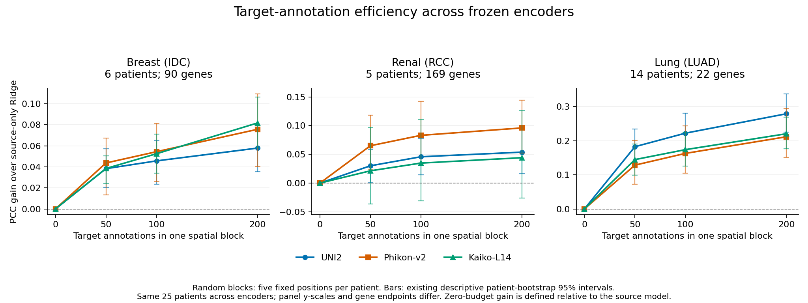

# 单细胞与空间组学科研实践

面向企业导师双选的项目展示：公开数据处理、AI模型适配、跨队列评估和科研工程实践。内容来自已完成的阶段性实验；不是已发表论文，也不宣称原创基础模型。

## 项目入口

| 项目 | 内容 | 入口 |
|---|---|---|
| 病理图像与空间表达预测 | 3个癌种、25位目标患者、3种病理编码器、6种选块策略；模型×标注因素分解 | [项目说明](projects/spatial-expression/README.md) |
| RNA–蛋白配对细胞识别 | CITE-seq数据对齐、scMMT适配、部分标签监督及双向迁移评估 | [项目说明](projects/citeseq/README.md) |
| 连续ROI外推的可靠性评估 | 校准布局、覆盖率与区间宽度；14位胰腺癌患者确认 | [项目说明](projects/roi-reliability/README.md) |
| 科研工程实践 | GPU资源管理、数据校验、可追溯配置与失败恢复 | [项目说明](projects/research-engineering/README.md) |

## 代表性已完成结果

同一测量区块预算200个spot、相同测试区的模型×标注比较：

| 场景 | 目标患者 | 基因端点 | 源域Ridge | Ridge＋200标注 | TRIPLEX＋200标注 |
|---|---:|---:|---:|---:|---:|
| 乳腺癌 | 6 | 90 | 0.472 | 0.539 | 0.566 |
| 肺癌 | 14 | 22 | 0.287 | 0.565 | 0.583 |

指标为患者等权的平均基因PCC；TRIPLEX为3个固定种子、每患者5个固定区块位置的平均。不同癌种端点不同，不直接合并绝对PCC；同域Ridge是观测参照，不是性能上限。见[结果表](results/model_annotation_2x2.csv)。



上图来自已完成的3编码器评估，与上表的匹配2×2比较属于不同实验口径；请分别读取对应结果表。图中的源域对照为各编码器的Ridge，不代表最强无标注方法。

## 可以运行什么

```bash
python -m pip install -r requirements.txt
python scripts/summarize_results.py
python examples/synthetic_demo.py
python -m src.interval_math
```

第一条脚本读取真实已完成结果；后两条使用合成数据检查流程和数学实现，输出不能当作科研成绩。可选的PyTorch部分标签损失见[src/citeseq_losses.py](src/citeseq_losses.py)。

这是展示与便携评估工具仓库，不是完整原始数据/权重包。深度模型的完整训练依赖公开数据、作者模型和相应许可；展示版未收录私人服务器配置、认证信息、原始组学数据或模型权重。

## 研究边界与来源

- 25位患者经历多轮开发分析；不能把重复观察称为新的独立确认。
- 选块收益较小，聚类策略合并比较经多重校正后不显著；保留负结果与失败筛查记录。
- 肺癌为同中心的跨平台场景，不应表述为纯跨机构泛化。
- CITE-seq两来源均为单生物学供者；技术分管、随机种子不等于独立供者。
- ROI布局确认涉及另一组14位患者，结论限定于覆盖—宽度取舍，不是新方法或理论保证。
- 尚在运行或适用性未核实的模型不进入已完成成绩表。

[数据与方法来源](docs/sources.md) · [结果文件说明](results/README.md) · [导出溯源](provenance.json)

项目采用AI辅助编码与排错；使用的算法和模型注明原作者来源。代码展示不意味着原创算法贡献。
